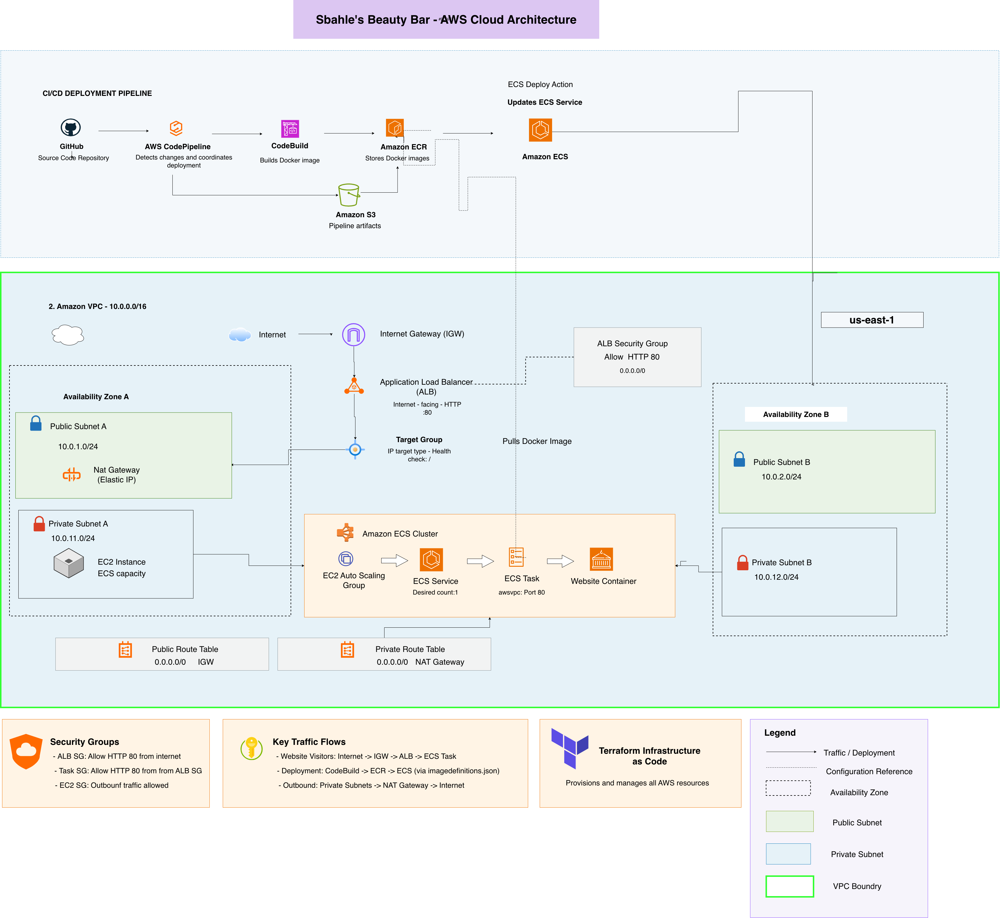

# Sbahle's Beauty Bar - Salon Booking Website

## About the Project

Sbahle's Beauty Bar is a salon website I developed as a personal project after noticing discussions on TikTok about the challenges salon owners face when managing customer bookings through WhatsApp.

Many small salon businesses rely heavily on social media platforms such as TikTok to promote their services and communicate with customers. However, managing a high volume of booking enquiries through WhatsApp can become difficult, while relying on social media alone can limit a business's online presence if an account becomes restricted or banned.

The goal was to create a more organised booking experience for customers while giving salon businesses an additional platform to showcase their services beyond social media.

## Key Features

- Service Browsing - Customers can explore the salon's services
- Online Appointment Booking - Customers can book appointments through the wesbite
- Business Online Presence - Provides a dedicated platform for showcasing salon services outside social media

## Technologies Used

### Frontend

- React.js
- JavaScript
- HTML
- CSS

### Cloud & DevOps

- Amazon Web Services (AWS)
- Elastic Container Service (ECS)
- Docker
- CI/CD
- Terraform

### AWS Architecture

### Deployment & Infrastructure

I used AWS to deploy the application and gain practical experience with cloud infrastructure and DevOps practices

The deployment involved:

- Docker - Containerising the application
- Amazon ECR - Storing Docker Images
- Amazon ECS - Running and managing application containers
- Terraform - Provision and managing AWS infrastructure as code
- CI/CD - Automating application deployment through AWS CodePipeLine and AWS CodeBuild

### What I Learned

Through this project, I gained practical experience in:

- Building a React.js application
- Understanding real-world business challenges and developing software solutions around them
- Containerising applications using Docker
- Deploying containerised applications on AWS ECS
- Managing cloud infrastructure using Terraform
- Understanding CI/CD concepts and automated deployment
- Working with AWS services such as ECR, ECS, and related infrastructure components

### Developed as a personal frontend development and cloud deployment project.

